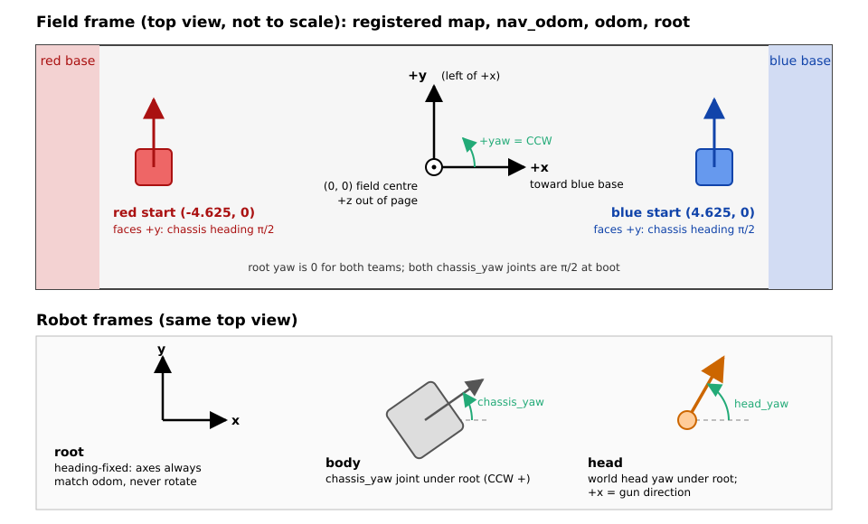

# MCB ↔ Jetson UART protocol

Reference for every message crossing the serial link. Jetson side:
`include/dji_serial_bridge/dji_protocol.hpp`. MCB side: `JetsonSubsystem.hpp`
in the firmware repo.

Wire layout or firmware behavior changes require firmware coordination; see
[MCB firmware coordination](README.md#mcb-firmware-coordination). The idle-frame
semantics below leave the wire layout and firmware unchanged.

## Framing

All multi-byte fields little-endian. Structs are `__attribute__((packed))`;
no padding.

```
[0]      0xA5         frame head
[1-2]    dataLength   payload byte count (uint16_t LE)
[3]      seq          rolling sequence counter, wraps at 256
[4]      crc8         CRC-8 over bytes [0..3]
[5-6]    msgType      message ID (uint16_t LE)  ← enum McbMsgType
[7..N]   payload      dataLength raw bytes
[N+1,2]  crc16        CRC-16 over bytes [0..N]  (uint16_t LE)
```

Header 7 bytes, trailer 2, frame size `payload + 9`. Payload offsets in the
tables below are relative to the payload start; add 7 for the frame offset.

`seq` increments per transmitted frame and is not checked on receive. The
MCB sends 0 on every frame (`UARTCommunication.cpp:21`). No
retransmission, acknowledgement or flow control in either direction.

## Message types

| ID | Name         | Direction     | Payload struct      | Bytes | ROS topic      | ROS type                             | Rate          |
|----|--------------|---------------|---------------------|-------|----------------|--------------------------------------|---------------|
| 0  | `NAV_GOAL`   | Jetson → MCB  | `NavGoalPayload`    | 8     | `~/nav_goal`   | `geometry_msgs/msg/PointStamped`     | on publish    |
| 1  | `CV_TARGET`  | Jetson → MCB  | `CvTargetPayload`   | 15    | `~/cv_target`  | `dji_serial_bridge/msg/CVTarget`     | on publish    |
| 2  | `POSE`       | MCB → Jetson  | `PosePayload`       | 25    | `~/pose`       | `dji_serial_bridge/msg/RobotPose`    | 90 Hz         |
| 3  | `REF_SYS`    | MCB → Jetson  | `RefSysPayload`     | 11    | `~/ref_sys`    | `dji_serial_bridge/msg/RefSysStatus` | 10 Hz         |
| 4  | `RELOCALIZE` | Jetson → MCB  | `RelocalizePayload` | 8     | `~/relocalize` | `geometry_msgs/msg/PointStamped`     | on correction |
| 5  | `PING`       | both          | `PingPayload`       | 1     | `~/ping_to_mcb`, `~/ping_from_mcb` | `dji_serial_bridge/msg/Ping` | on publish / on echo |

| 6 | `DEBUG` | MCB → Jetson | opaque bytes | 0–32 | `~/debug` | `dji_serial_bridge/msg/DebugBlob` | caller-driven, best effort |

Each message is named after its topic, and its payload fields after the ROS
fields they carry. IDs 0-6 match `enum UartMessage` in the firmware's
`JetsonSubsystem.hpp`. Topics are in the node's private namespace:
`~/nav_goal` is `/dji_serial_bridge/nav_goal` unless remapped. The firmware
sends nine POSE then one REF_SYS on one 10 ms timer.



**Field-aligned frames.** Both wire frames use REP-103 metres/radians,
z up, x toward blue's base, y left. Raw POSE/CV_TARGET coordinates boot at
(0, 0) for both teams and remain relative to that physical start. Navigation
coordinates become field-centred after the Jetson's startup RELOCALIZE:
the position comes from that team's Jetson launch configuration, not firmware.
`thornbots_pkg/auto.launch.py` owns `red_start_x`, `red_start_y`, `blue_start_x`,
`blue_start_y` defaults; `/etc/thornbots/launch.env` can override each independently
through `AUTO_LAUNCH_ARGS` ([configuration](../thornbots_pkg/README.md#point_to_cv_target)).
Both teams face +y at boot (chassis heading π/2).
`root` stays heading-fixed at yaw 0 for both teams; both `chassis_yaw` joints
should be π/2. This is the physical boot contract, not proof of firmware
configuration or telemetry: current POSE omits chassis yaw and the bridge
publishes its zero placeholder (see [proposed chassis yaw](#proposed-pose-chassis-yaw)).
POSE and CV_TARGET use continuous raw pod odometry (`odom` on the Jetson),
which RELOCALIZE and team selection never move.
NAV_GOAL and RELOCALIZE use the
corrected navigation frame (`nav_odom` on the Jetson). RELOCALIZE changes
only the MCB's navigation offset; it cannot move POSE or an existing aim
point. Navigation offsets are translation-only; these frames keep the same
axes. MCB navigation is initially start-relative; autonomous routes and
NAV_GOAL driving wait for the first RELOCALIZE. The Jetson waits for the
referee team, seeds navigation at raw position plus that team's start, and
sends the absolute navigation position. AMCL also waits for that team before
starting with its team-start prior; it never uses global localization.
Raw odometry can drift,
as [REP 105](https://github.com/ros-infrastructure/rep/blob/master/rep-0105.rst)
permits. Neither raw odometry nor an aim point is a global localization fix.

An inbound frame with any other `msgType` is counted, logged at WARN, dropped.

---

## Jetson → MCB

Transmitted from the subscriber callback: one ROS message in, one frame out.
No timer, no retransmission; the wire rate is the publisher's rate. Fields are
copied without clamping; CV_TARGET has the freshness gate below.

### MCB receive

The MCB stores incoming frames in one `mostRecentMessage` slot, shared by
all message types. `getMsg` consumes it only when the type and payload size
match its caller. A second frame received before consumption overwrites the
first, including PING, RELOCALIZE and NAV_GOAL. There is no queue or
application acknowledgement; successful Jetson transmission does not prove
that the MCB applied a command.

### NAV_GOAL (id=0) — navigation goal

8-byte payload, 17-byte frame. Subscribed on `~/nav_goal`
(`geometry_msgs/msg/PointStamped`, depth-10 reliable). `point.z` and the
header are discarded.

| Off | Size | Type    | Field     | From      |
|-----|------|---------|-----------|-----------|
| 0   | 4    | float32 | `x`       | `point.x` |
| 4   | 4    | float32 | `y`       | `point.y` |

A goal in the corrected navigation frame, metres, consumed by its autonomous
drive controller only after its first RELOCALIZE. No publisher in this workspace: `mcb_relay` wires up
`~/cv_target` and `~/relocalize` only.

### CV_TARGET (id=1) — aim point and fire decision

15-byte payload, 24-byte frame. Subscribed on `~/cv_target`
(`dji_serial_bridge/msg/CVTarget`, SensorDataQoS, best-effort).

| Off | Size | Type    | Field        | From                          |
|-----|------|---------|--------------|-------------------------------|
| 0   | 4    | float32 | `x`          | `CVTarget.x`                  |
| 4   | 4    | float32 | `y`          | `CVTarget.y`                  |
| 8   | 4    | float32 | `z`          | `CVTarget.z`                  |
| 12  | 2    | uint16  | `delay_ms`   | `CVTarget.delay_ms`           |
| 14  | 1    | uint8   | `flags`      | packed booleans, below        |

| Bit | `CVTarget` field      | Set means                                        |
|-----|-----------------------|--------------------------------------------------|
| 0   | `fire`                | request this aim point to exit `delay_ms` after receipt |
| 1   | `type_c_based_patrol` | MCB permission to patrol on its own; clear stops it |
| 2   | `turn_to_hit`         | MCB permission to turn toward where it got hit  |
| 3   | `patrol`              | idle/non-target aim point |

Bits 4-7 are reserved, sent as 0. Bit 3 is informational and currently
ignored by firmware; it does not gate bit 0 or otherwise change firing. The
`patrol` field name and bit position are unchanged: it now marks an idle,
non-target point, not a Jetson sweep patrol. Bit 1 remains separate permission
for firmware patrol after aim expiry. The bridge packs these booleans without
interpreting them, as it unpacks REF_SYS's.

Bits 1 and 2 reach the MCB with every frame. The Jetson clears bit 2 while
holding a target estimate, including a coasting/predicted track during brief
occlusion and an unconverged estimate. Every idle/non-target frame sets bit 2
(`turn_to_hit`) and bit 3 (`patrol`), with `fire` clear. There is no cooldown;
the next target frame clears bit 2 and cancels any firmware hit turn.

The Jetson decides aim and fire itself. It requests fire only while the newest
detection is at most 0.15 s old (`fire_max_state_age_s`); this is a necessary
freshness condition, not permission to bypass other firing gates. It continues
aiming without firing through a brief detection gap until the 0.5 s target
timeout (`target_timeout_s`). Prediction does not refresh detection age.

There is no Jetson patrol. After the target timeout, the Jetson keeps sending
non-firing idle aim points instead of going silent, preserving hit-turn
permission in the last frame's flags. Idle looks can hold the last enemy
position, follow the gun after a firmware hit turn, check a lidar track or face
the enemy starting zone; their selection belongs to `thornbots_pkg` (see the
[lidar-guided aiming design](../docs/lidar-guided-aiming-2026-10-25.md#where-the-head-looks-with-no-camera-target)).
The MCB aims at received points while valid; bits 1 and 2 separately permit
firmware patrol after expiry and interruption toward a hit.

No stamp crosses the wire (dropped 2026-10-03 to match MCBV3
`position-based-cv`'s 15-byte `CvTarget`): the MCB runs `delay_ms` from frame receipt.

Aim and fire travel as one frame on purpose. A fire delay is only meaningful
against the aim point it was solved for; two frames could arrive apart, drop
independently, or pair up wrongly on the MCB and fire at a point the delay
was never computed for. `delay_ms` includes the estimated indexer latency plus any alignment wait.
Firmware requests indexing after `max(0, delay_ms - FIRING_LATENCY_TIME)`;
its configured latency and calibration limits live in
[MCBV3 aiming](../firmware/MCBV3/README.md#aim-and-navigation-odometry).
A delay shorter than that latency requests indexing immediately; physical
exit still takes time. `delay_ms` = 0 with `fire` set means request now;
`fire` clear means `delay_ms` is meaningless. While a request is pending the
MCB holds that frame and reads no newer one, so the following 40 Hz frames
cannot cancel the shot. The sentry's latency is 20 ms (timed on the robot),
and Jetson never sends `fire` with `delay_ms` under 25
([`min_fire_delay_s`](../thornbots_pkg/README.md#point_to_cv_target)).

`x/y/z` is a world-frame position in metres in raw aim `odom` (z up).
The firmware subtracts its never-relocalized, field-aligned pod position.
The MCB holds the point with its IMU and
odometry while the chassis moves and turns, then aims at it and applies its
own gravity, drag and muzzle geometry. It is not a root- or camera-frame
offset and not a barrel attitude. Velocity
and spin are not on the wire; they are ROS-internal on `/cv/target_state`
(`TargetState.msg`).

### CV decision freshness

The detection-age fire limit above is enforced by the producer; the bridge
only sees the decision stamp and cannot infer the newest detection age.

The bridge drops the entire CV_TARGET (including aim-only/idle frames) unless
its original decision stamp is nonzero, well formed and less than 200 ms old
at the final write boundary. Exactly 200 ms is expired. This matches the
firmware target-validity interval as a Jetson-side age budget; firmware still
starts its separate 200 ms validity timer at receipt. No stamp, payload,
flag or `delay_ms` is rewritten, and expiry does not send a replacement fire
command. Firmware physical firing gates and receipt expiry still apply.

The check runs after acquiring the write mutex and building the frame, directly
before a single nonblocking write. A nonempty or unreadable serial output queue
also drops the frame: no previous software TX backlog may delay it. There is
no wait/retry after validation; EAGAIN and short writes fail. This bounds
executor/mutex/write queuing on the Jetson. Normal 24-byte transmission takes
about 2.1 ms at 115200 baud. Driver/hardware stalls after write acceptance and
MCB scheduling are outside this software bound; end-to-end expiry would
require a shared clock/deadline wire contract.

Producer and bridge must use the same ROS clock and `use_sim_time` setting.
Negative seconds, nanoseconds outside [0, 1e9), zero/unstarted clocks, future
stamps (including after a backward clock reset), and ages of 200 ms or more
are rejected. There is no future tolerance or wall-time fallback. Simulation
may use positive subsecond stamps; pausing ROS time pauses decision age too.
An epoch mismatch normally appears expired or future and is rejected; stamps
carry no clock identifier, so coincident numeric times from different clocks
cannot be detected here. Configure the clock consistently across the graph.

### RELOCALIZE (id=4) — lidar position fix

8-byte payload, 17-byte frame. Subscribed on `~/relocalize`
(`geometry_msgs/msg/PointStamped`, depth-10 reliable). `point.z` and the
header are discarded.

| Off | Size | Type    | Field       | From      |
|-----|------|---------|-------------|-----------|
| 0   | 4    | float32 | `x`         | `point.x` |
| 4   | 4    | float32 | `y`         | `point.y` |

The localization-estimated position in corrected navigation `nav_odom`, metres.
The MCB sets its navigation offset against its current raw pod position.
Navigation controllers see this correction; raw POSE and gimbal aim do not.
The first accepted fix enables autonomous navigation. To tolerate a lost frame
in the single receive slot, `mcb_relay` repeats each correction three times
after its first send, at least 0.3 s apart, using fresh localization/raw inputs
and the same confidence gate. These are newly predicted absolute positions,
not cumulative deltas. The bounded repeats do not prove receipt if all four
frames are lost; there is no acknowledgement in this payload.
The node logs every transmission beside the latest raw `~/pose`; those
coordinates are in different frames after a correction.

---

## MCB → Jetson

A dedicated read thread polls the port, scans for `0xA5`, checks CRC-8 over the
header and CRC-16 over the frame (both dropped on mismatch while `enforce_crc`
is true), then checks payload length against the struct size before publishing.
`header.stamp` on both published messages is when the MCB started sending the
frame: the read time of its last byte less the frame's wire time at `baudrate`
(10 bits per byte). No MCB clock is on the wire, and the USB-serial latency
before a read is not taken off. A frame whose send start would precede clock
zero (bytes read before a simulated clock starts) is dropped with a warning.

### POSE (id=2) — chassis pose and gimbal angles

25-byte payload, 34-byte frame, 90 Hz. Published on `~/pose`
(`dji_serial_bridge/msg/RobotPose`, SensorDataQoS).

| Off | Size | Type    | Field         | Meaning                                  |
|-----|------|---------|---------------|------------------------------------------|
| 0   | 4    | float32 | `x`           | chassis X, raw aim odom, metres          |
| 4   | 4    | float32 | `y`          | chassis Y, raw aim odom, metres          |
| 8   | 4    | float32 | `vel_x`      | chassis X velocity, m/s                  |
| 12  | 4    | float32 | `vel_y`      | chassis Y velocity, m/s                  |
| 16  | 4    | float32 | `head_pitch` | gimbal pitch encoder value, radians      |
| 20  | 4    | float32 | `head_yaw`   | gimbal yaw, field, CCW, `(-2pi, 2pi)`, rad  |
| 24  | 1    | uint8   | `odom_status`| which source produced x/y/vel, below     |

| Code | `RobotPose` constant         | Source of `x/y/vel_x/vel_y`                  |
|------|------------------------------|----------------------------------------------|
| 0    | `ODOM_PODS`                  | odometry pods, healthy                       |
| 1    | `ODOM_DRIVETRAIN`            | drivetrain odometry, degraded by wheel slip  |
| 2    | `ODOM_I2C_DEAD`              | none: I2C bus dead, no pod data, no fallback |
| 3    | `ODOM_I2C_DEAD_DRIVETRAIN`   | drivetrain odometry, pods lost to a dead I2C |

Codes 1 and 3 are reserved. Sentry firmware sends `ODOM_I2C_DEAD` (2) before
its first successful Pico read and once the last successful read is 500 ms
old, otherwise `ODOM_PODS` (0). Pico values refresh about every 260 ms. A read
that succeeds with frozen values still reports 0, so frozen pods are not
flagged on the wire.
Hero and standard have no odometry: they always send `x/y/vel` 0 with code 2,
and `head_yaw` without a start yaw.

`x/y` start at zero for both teams; velocity and `head_yaw` share the raw
field-aligned aim axes (above).
RELOCALIZE never changes them. Taproot IMU yaw is non-negative, but the
gimbal yaw estimator extrapolates it without wrapping. POSE applies
`std::fmod(estimated_yaw + start_yaw, 2*pi)`, which preserves sign, so
`head_yaw` can be negative. Consumers needing `[0, 2pi)` must wrap it.

Code 2 means the fields have no source behind them. Codes 1 and 3 mean they
are drivetrain-derived and drift under wheel slip. `head_pitch` and `head_yaw`
are independent of the odometry status and are unaffected. The node copies
the byte through without validating it against the table. Transitions are logged: INFO back to
pods, ERROR into 2, WARN into 1 or 3.

### Proposed: POSE chassis yaw

Not applied: the bytes above are what both sides send today. `RobotPose`
already has `chassis_yaw` and `chassis_yaw_rate`, published as 0. Proposed
2026-09-29, to agree with the firmware side; see
[aim and navigation frames](README.md#aim-and-navigation-frames):

| Off | Size | Type    | Field              | Meaning                                    |
|-----|------|---------|--------------------|--------------------------------------------|
| 25  | 4    | float32 | `chassis_yaw`      | chassis heading, world, same sense and zero as `head_yaw`, radians |
| 29  | 4    | float32 | `chassis_yaw_rate` | its rate, rad/s                            |

33-byte payload. The firmware has the field heading as
`getYawAngleRelativeWorld() + getStartYaw() - getYawEncoderValue()` (the negative of
`AutoDriveCommand`'s `referenceAngle`), and the rate as the turret IMU's yaw
rate less the yaw motor's. `thornbots_pkg` turns it into the `chassis_yaw`
joint only: `root` stays heading-fixed, so localization doesn't read it.

### REF_SYS (id=3) — referee system status

11-byte payload, 20-byte frame, 10 Hz, interleaved with POSE. Published on
`~/ref_sys` (`dji_serial_bridge/msg/RefSysStatus`, SensorDataQoS).

| Off | Size | Type    | Field                    | Meaning                                   |
|-----|------|---------|--------------------------|-------------------------------------------|
| 0   | 1    | uint8   | `game_stage`             | referee game stage enum value             |
| 1   | 2    | uint16  | `stage_time_remaining`   | seconds left in the current stage         |
| 3   | 2    | uint16  | `robot_hp`               | current robot HP                          |
| 5   | 1    | uint8   | `robot_id`               | normalised to red-team numbering (hero=1) |
| 6   | 4    | float32 | `delta_angle_got_hit_in` | radians from current chassis heading toward last hit, positive CCW (REP 103); 123 if none |
| 10  | 1    | uint8   | `booleans`               | 8 flags, MSB first, table below           |

| Bit | Firmware name            | `RefSysStatus` field       | Meaning                           |
|-----|--------------------------|----------------------------|-----------------------------------|
| 7   | `isOnBlueTeam`           | `is_on_blue_team`          | blue team, else red               |
| 6   | `isHealing`              | `is_healing`               | HP currently restoring            |
| 5   | `isInReloadZone`         | `is_in_reload_zone`        | restoration or exchange zone RFID |
| 4   | `isInCenterZone`         | `is_in_center_zone`        | central buff RFID                 |
| 3   | `teamOccupiesCenter`     | `team_occupies_center`     | our team holds the central buff   |
| 2   | `opponentOccupiesCenter` | `opponent_occupies_center` | opponent holds it                 |
| 1   | `chassisHasPower`        | `chassis_has_power`        | chassis power output on           |
| 0   | `gimbalHasPower`         | `gimbal_has_power`         | gimbal power output on            |

The hit angle is relative to the chassis heading when REF_SYS is sent, not
the gimbal heading. Left is positive and right negative, wrapped to
`[-pi, pi]`; 123 means no hit since the preceding REF_SYS frame.
Firmware retains the latest hit bearing across control cycles until a
REF_SYS frame successfully reports it. Multiple hits before that report
replace the pending bearing; a following report without a new hit carries 123.
The node unpacks the byte into the eight named booleans.

---

### DEBUG (id=6) — opaque firmware debug

The payload is 0–32 uninterpreted bytes, with no tags, schema or padding.
`dataLength` is its exact length; frames are 9–41 bytes. The bridge publishes
`DebugBlob.data` unchanged on `~/debug` with SensorDataQoS, empty `frame_id`
and the same estimated frame send-start stamp as POSE. Oversized debug headers
are rejected before waiting for the payload. Firmware developers own offline
decoding against the firmware revision that produced the bag.

`JetsonSubsystem::sendDebug(data, length)` is a nonblocking, bounded API for
cooperative firmware callers; there is no production sender or sampling timer.
Debug is expendable: queue rejection, link saturation and ROS best-effort loss
are allowed. It has no effect on robot behavior and no acknowledgement.
The firmware gives control traffic priority and limits debug to at most one
frame per 100 ms (410 wire bytes/s for maximum payloads, including framing).
Only idle UART slack that can finish before the next 10 ms POSE/REF_SYS slot
may carry debug. See the firmware's [debug API](../firmware/MCBV3/README.md#opaque-debug-blobs)
for scheduling and caller lifetime rules. RX continues independently; debug
must not overwrite a received CV_TARGET or RELOCALIZE mailbox.

The startup per-run recorder includes `/dji_serial_bridge/debug` in normal
and match runs whenever bag recording is enabled. No content is enabled by
default; individual firmware developers choose what and when to send.

---

## Either direction

### PING (id=5) — MCB Mapping Machine and link check

1-byte payload, 10-byte frame. The same ID both ways; the direction tells
them apart. Jetson → MCB: subscribed on `~/ping_to_mcb`, header discarded.
MCB → Jetson: published on `~/ping_from_mcb`, stamped like POSE. Both
`dji_serial_bridge/msg/Ping`, depth-10 reliable.

| Off | Size | Type    | Field    | From / to     |
|-----|------|---------|----------|---------------|
| 0   | 1    | uint8   | `number` | `Ping.number` |

The MMM application contract below uses the existing payload and UART ID.
The bridge remains a pure translator; Jetson coordination belongs to the
in-stack C++ [`mmm` node](../thornbots_pkg/README.md#mcb-mapping-machine).
[MCB receive](#mcb-receive) can lose frames before consumption.

| number | Origin | Meaning | Exchange (C = MCB, J = Jetson) |
| --- | --- | --- | --- |
| 0 | J | Main-only link check | J→C 0, C→J 0; no third leg |
| 1 | C | Start mapping | C→J 1, J→C 1, C→J 1, J→C 1; C ignores |
| 2 | J | Ready at captured start | J→C 2, C→J 2, J→C 2; C echoes again, J ignores |
| 3 | C | Save asynchronously | C→J 3, J→C 3, C→J 3, J→C 3; C ignores |
| 4 | J | Mapping / away from start; Done→Mapping after failed Ready save | J→C 4, C→J 4, J→C 4; C echoes again, J ignores |
| 6 | J | Setup failed | J→C 6, C→J 6, J→C 6; C echoes again, J ignores |

Only C owns the states. Main --1--> Setup mapping --2--> Ready to save;
Ready to save --4--> Mapping --2--> Ready to save. Ready to save --3--> Done;
Done --4--> Mapping. Setup mapping --6--> Done.
Mapping --3--> Save incomplete, immediately back to Mapping. Setup disables
drive and looks forward. Ready gives green LED/1 Hz beep, forward head and
slow drive capped at 0.4 m/s. Mapping locks the forward head and uses the same
drive cap. Done disables drive and permits power-off, with no head-down pose.
C replies to 0 only in Main;
it ignores 0 elsewhere. Zero is the one exception to always-ack by prior user
decision and never changes state. Unknown numbers are ignored, never echoed.

J publishes 0 once per wall second. Even transactions allow one outstanding
number, retry every 0.5 wall seconds, and stop after ten sends (timeout at
5 seconds). A matching echo ends retries and emits one final leg; unsolicited,
late-after-timeout and duplicate even echoes are ignored. Timeout logs an
error and the coordinator retries the latest pose condition after a five-second
quiet interval. A completed/timed-out even number cannot be reused for five
seconds. A changed pose condition waits for the outstanding transaction to end.
C echoes every received 2/4/6, including retries and final legs: it cannot
distinguish them. It changes state only once from a legal source state;
repeated requests remain idempotent, including recovery after an uncertain
timeout. J ignores echoes when it is not waiting for that number, ending the exchange.

There is no sequence/transaction field. J echoes **every** received 1/3 in any
state, even an illegal request, duplicate, retry or C's final leg, **before**
dispatching any work. The five-second sliding same-number receive window gates
only work: J dispatches only after at least five wall seconds without that
number. A distinct new same-number request within that window is ACKed but not
executed. C retries an unacknowledged 1/3 at intervals of at least 0.5 wall
seconds; J ACKs retries immediately. C sends its final leg only once, on a
matching echo while awaiting it, then ignores duplicate/late echoes in every
state. A start after the quiet interval begins a new Jetson session, including after
an MCB restart or setup failure; while a save is running J rejects it with 6.
This new session cancels the previous even transaction and clears its completed
state and cooldowns so the new setup can report 2/6. Odd receive windows remain
in force. J acknowledges a save already running with a loud warning. Repeated
saves after the quiet interval are new requests.

The receiver of a number originated by its peer always echoes it (J for 1/3,
C for 2/4/6), while work and state changes happen at most once. The originator
echoes its peer's echo only once while awaiting it, then ignores further
echoes. Thus the receiver ACKs the final leg, and the originator consumes that
ACK without sending again; retries cannot sustain an echo loop.

These rules require each frame and its resulting echo to expire within five
seconds of the originating send, and no concurrent
same-number odd request. Arbitrarily delayed final legs and fresh requests
are indistinguishable on this wire; delivery/exactly-once execution across
coordinator or MCB restarts is not guaranteed. On coordinator restart begin a
new attempt from MCB Main. Disable other PING publishers/diagnostics while MMM
runs. Ack means receipt, **never successful save or durable storage**. J treats
3 as a Ready save only when its last completed even exchange was 2 and its
local start gate still passes; otherwise it takes an incomplete snapshot.
After a successful validated save, J may request its opt-in host shutdown
mechanism. Only when a Ready save fails to start or complete, J sends 4
to return C from Done to Mapping. J waits for that exchange to complete before
resuming pose announcements, sending 2 again if its start gate passes; the
five-second same-number even reuse cooldown still applies. Failed incomplete
snapshots and shutdown-request failures after a successful save do not trigger this 4.
Save failure leaves J running for recovery; snapshots never shut it down.
In Main, Setup mapping and Mapping, 4 is echoed without changing state;
Ready to save still transitions to Mapping on 4. Setup transitions to Done on 6;
every other state echoes 6 without a state change. J sends 6 on setup timeout,
reset/input failure, or a running localization mode other than mapping.
C powers off its own side independently, so Done can still interrupt
storage if that also removes Jetson power before the save finishes.

---

## Not on the wire

The hosted fixture and Renode board adapter's `MCB3` motor/sensor pipe belongs to the
[sim hardware fixture](../sim/README.md#mcb-emulator). It does not add a UART
message or change any payload, baud rate or stamp contract here.

`PanelDetection`, `PanelDetectionArray` and `TargetState` are ROS-internal,
travelling between `thornbots_pkg` and the CV pipeline.

`FireCommand` is gone as of 2026-09-20: it was merged into `CVTarget` as
`fire` + `delay_ms`, and `CV_TARGET` (id=1) grew `stamp_ms` so the delay had a
reference the MCB could age. `CvTargetPayload` went 17 → 23 bytes, then 19 on
2026-10-02 when `confidence` went (every frame is an aim point), then 15 on
2026-10-03 when `stamp_ms` went to match `position-based-cv`'s `CvTarget`.

Same two-repos-one-change rule as every other wire edit; see README.md's "MCB
firmware coordination".
